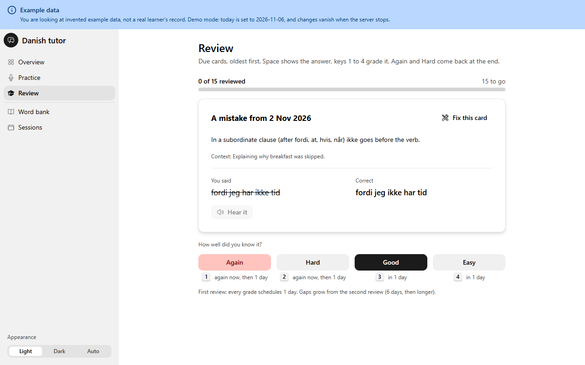
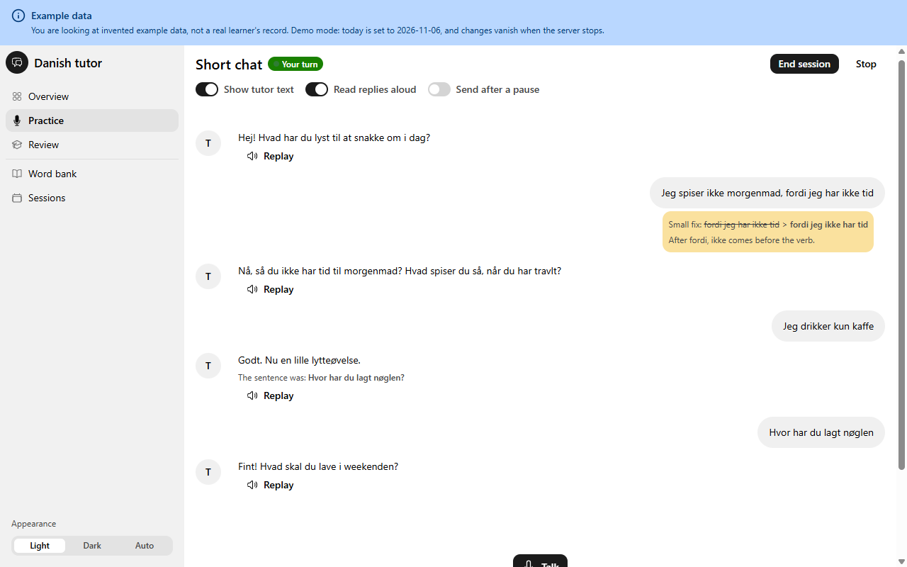

# danish-tutor


Spoken Danish practice in a local web app: a relaxed chat with small corrections as you go, a hidden listening drill, ten new words at a time, and spaced repetition. For learners around A2 to B1. It installs as a Claude Code plugin; the tutor runs on the Anthropic API.

From the invented example data:

```
Tutor:   Hej! Hvad har du lyst til at snakke om i dag?
Learner: Jeg spiser ikke morgenmad, fordi jeg har ikke tid.
         Small fix: fordi jeg har ikke tid > fordi jeg ikke har tid
```

The fix becomes an error card for review.

## What you need

- **Python 3.10+.** On Windows, tick "Add python.exe to PATH" in the installer.
- **The Anthropic SDK:** `pip install anthropic`. Without it, only Practice is unavailable.
- **An Anthropic API key** from console.anthropic.com, in the environment variable `DANISH_TUTOR_ANTHROPIC_KEY` (or `ANTHROPIC_API_KEY`, or sign in with `ant auth login`). The app never asks for it, stores it or shows it.
- **A Danish voice** for listening: a system voice (Windows: Settings > Time & language > Language & region, add Danish with speech; macOS: System Settings > Accessibility > Spoken Content), or optionally a local text-to-speech daemon (`docs/details.md`).
- **Edge or Chrome** for the Talk button. Typing or any dictation tool works too.

Node is not needed. Claude Code is only needed to install the plugin.

## Install and start

In Claude Code:

```
/plugin marketplace add batutho-dot/danish-tutor
/plugin install danish-tutor@danish-tutor
```

Then type `/dansk`; it starts the app. Without Claude Code: `python scripts/dansk_app.py` (add `--demo` to try it on invented data).

Optional settings: copy `skills/dansk/config.example.json` to `~/.claude/danish-tutor/config.json`.

## The app

- **Practice:** Speaking (15 minutes), Short chat (5), Listening drill, Learn 10 new words. Talk or type. Replies are read aloud; switch off "Show tutor text" to practise by ear. The session is saved at the end.
- **Review:** due cards, oldest first. Error cards show the mistake, where it came up, what you said and the correct form. Again and Hard come back at the end. "Fix this card" edits or deletes a card.
- **Overview, Word bank, Sessions:** what is due, your streak, your words, past sessions.




Scheduling is SM-2 (Wozniak 1990), in `scripts/dansk_db.py`.

## Your data and privacy

Your record is one SQLite file, `~/.claude/danish-tutor/dansk.db`, created on first start. The conversation text goes to the Anthropic API under your key. The Talk button uses your browser's speech recognition, which may send audio to the browser maker. The app listens on 127.0.0.1 only.

Coming from the Fluent plugin? Import once:

```bash
python scripts/import_fluent.py --data <your Fluent data folder> --words <your word notes folder>
```

## Limits

- The tutor's Danish is not checked against a dictionary.
- Listening needs a Danish voice; Windows and macOS do not always ship one.
- No claim about learning gains is made.

## Licence

PolyForm Strict 1.0.0 (`LICENSE`): free for noncommercial use; no distributing it, and no changes or new works based on it; commercial use needs permission. Versions up to commit 9ba8b3f were released under MIT. Bundled third-party code in `app/dist` keeps its own licences (`THIRD_PARTY_NOTICES.txt` there). `example-data/` is invented. More: [docs/details.md](docs/details.md).
