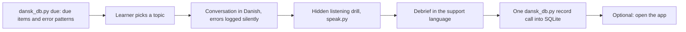
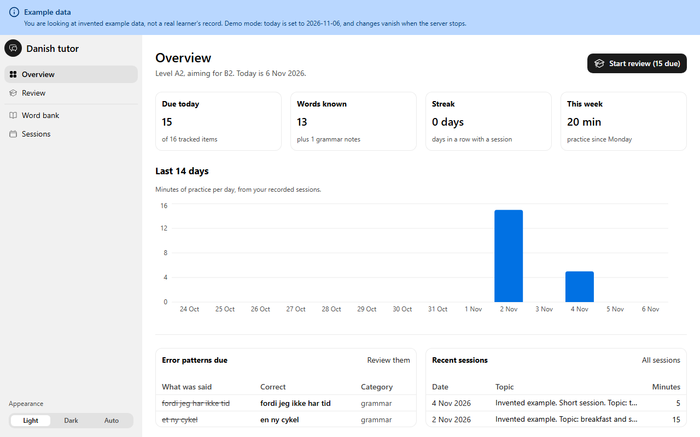

# danish-tutor


A Claude Code plugin for spoken Danish practice: a 15 minute conversation, a hidden listening drill, and spaced repetition. For learners around A2 to B1 who want to speak and listen, not fill in drills.

From the invented example session (English in brackets):

```
Tutor:   Hej! Hvad har du lyst til at tale om i dag?   (Hi! What would you like to talk about today?)
Learner: Morgenmad og at købe ind.                     (Breakfast and shopping.)
Tutor:   Hvad spiser du til morgenmad?                 (What do you eat for breakfast?)
Learner: Brød, men ikke i dag, fordi jeg har ikke tid. (Bread, but not today, because I don't have time.)
```

The word order slip ("har ikke" should be "ikke har") is logged silently and comes back in the debrief and later sessions.

## Install

You need Claude Code, Python 3.10+ and a Danish text-to-speech voice for the listening drill. Dictation is optional; typing works. In Claude Code:

```
/plugin marketplace add batutho-dot/danish-tutor
/plugin install danish-tutor@danish-tutor
```

Then type `/dansk` (`/dansk kort` for 5 minutes, `/dansk lyt` for listening only).

Optional settings (level, goal, support language, voice speed): copy `skills/dansk/config.example.json` to `~/.claude/danish-tutor/config.json`.

## How it works



Due items are woven into a conversation on your topic. Corrections wait until the debrief. Listening sentences are spoken, never shown first. One `record` call saves everything in one transaction and prints a line like `saved session-2026-11-02, 6 reviews, 3 new words, 1 errors; 9 items due tomorrow`. Scheduling is SM-2 (Wozniak 1990), in `scripts/dansk_db.py`.

## Your data

One SQLite file, `~/.claude/danish-tutor/dansk.db`, on your machine only. Coming from the Fluent plugin? Import once:

```bash
python scripts/import_fluent.py --data <your Fluent data folder> --words <your word notes folder>
```

## The app

```bash
python scripts/dansk_app.py
```

A local web app on your database: what is due, your streak and last 14 days, flip-card review (keys 1 to 4), a searchable word bank you can edit and prune, and your sessions. It listens on 127.0.0.1 only. "Hear it" uses your browser's Danish voice. No data yet? `--demo` serves a temporary copy of the invented example data.




`dashboard/build_dashboard.py` still writes a static export.

## Limits

- The Danish the model produces is not checked against a dictionary.
- The listening drill needs an installed Danish voice; Windows and macOS do not always ship one.
- SQLite only; the SQL is kept portable.
- No claim about learning gains is made.

## Licence

PolyForm Strict 1.0.0 (`LICENSE`): free for noncommercial use; no distributing it, and no changes or new works based on it; commercial use needs permission. Versions up to commit 9ba8b3f were released under MIT. Bundled third-party code in `app/dist` keeps its own licences (see `THIRD_PARTY_NOTICES.txt` there). `example-data/` is invented. More: [docs/details.md](docs/details.md).
