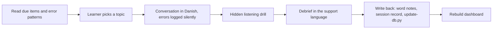

# danish-tutor

A Claude Code skill that runs a 15 minute spoken Danish practice session with hidden listening drills, silent spaced repetition and error logging, plus a local dashboard that shows the word bank and review queue.

**Result:** no benchmark exists for this tool. `python verify.py` checks that the scripts compile, the skill's frontmatter is valid, the dashboard builds from the invented example data with the expected words and due dates, and no file holds personal paths, names, keys or audio.

## Run it

Install the skill into Claude Code:

```bash
mkdir -p ~/.claude/skills && cp -r skill/dansk ~/.claude/skills/dansk
```

Optional settings (name, level, goal, support language, folders, listening voice):

```bash
mkdir -p ~/.claude/danish-tutor && cp skill/dansk/config.example.json ~/.claude/danish-tutor/config.json
```

Build the dashboard on the invented example data (it prints the page's path):

```bash
python dashboard/build_dashboard.py --data example-data
```

Build it on your own records:

```bash
python dashboard/build_dashboard.py --data ~/.claude/fluent-data --words ~/danish-tutor/data/words
```

Check the repository:

```bash
python verify.py
```

Then type `/dansk` in Claude Code (`/dansk kort` for 5 minutes, `/dansk lyt` for listening only).

## How it works



The skill reads the review queue, then weaves 6 to 8 due items into a conversation on the learner's topic. Corrections wait until the debrief. Listening sentences are spoken by a text-to-speech command and never shown before the learner answers. Afterwards the skill writes word notes and a session record, and hands review results and errors to the Fluent engine, which schedules the next reviews with SM-2. The dashboard is a static page built from those files.

## Results

A session writes three things. Shown here on the invented example data:

- A word note per new word, `words/noegle.md`: forms (`en nøgle, nøglen, nøgler, nøglerne`), Danish definition, example sentence, gloss (`key`).
- A session record, `sessions/dansk-session-2026-11-02.md`: topic, errors by category, listening sentences scored `understood_fully`, `gist_only` or `missed`, new words, time.
- One `update-db.py` call: review qualities, errors, new vocabulary.

On the invented example data the dashboard prints:

```
13 word notes, 1 grammar notes, 16 tracked items, 15 due on 2026-11-06
```

These numbers describe the invented files, not a learner's progress. No claim about learning gains is made.

## Limits

- Speech output needs a separate text-to-speech tool. The default listening command is the macOS `say` command; elsewhere, set `listen_command` or show the sentences as text.
- Scheduling depends on the third-party Fluent plugin's `update-db.py`, which is not included.
- Built for one learner's setup; other setups may need changes.
- Spoken input relies on the operating system's dictation.
- The Danish the model produces is not checked against a dictionary.

## Data and licence

Code and documentation: MIT, see `LICENSE`. Everything in `example-data/` is invented. Keep your own records in `data/`, which git ignores. The SM-2 engine and database writer come from the Fluent Claude Code plugin (marketplace `m98`); no Fluent files are copied here and its licence was not reviewed for this repository, so check it before you install it. More detail: [docs/details.md](docs/details.md).
