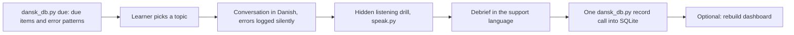

# danish-tutor

A Claude Code plugin for spoken Danish practice: a 15 minute conversation, a hidden listening drill, and spaced repetition that remembers what you learned.
For learners around A2 to B1 who want to speak and listen, not fill in drills.

From the invented example session (English in brackets):

```
Tutor:   Hej! Hvad har du lyst til at tale om i dag?   (Hi! What would you like to talk about today?)
Learner: Morgenmad og at købe ind.                     (Breakfast and shopping.)
Tutor:   Hvad spiser du til morgenmad?                 (What do you eat for breakfast?)
Learner: Brød, men ikke i dag, fordi jeg har ikke tid. (Bread, but not today, because I don't have time.)
Tutor:   Nå, så har du travlt i dag?                   (Oh, so you're busy today?)
Learner: Ja, og jeg har glemt min nøgle.               (Yes, and I have forgotten my key.)
```

The word order slip ("har ikke" should be "ikke har") is logged silently and comes back in the debrief and in later sessions.

## What you need

- Claude Code
- Python 3.10 or newer
- A Danish text-to-speech voice for the listening drill
- Microphone dictation (optional; typing works too)

No other plugin.

## Install

In Claude Code:

```
/plugin marketplace add batutho-dot/danish-tutor
/plugin install danish-tutor@danish-tutor
```

Then type `/dansk` (`/dansk kort` for 5 minutes, `/dansk lyt` for listening only).

Optional settings (name, level, goal, support language, voice speed). macOS or Linux:

```bash
mkdir -p ~/.claude/danish-tutor
cp skills/dansk/config.example.json ~/.claude/danish-tutor/config.json
```

Windows (PowerShell):

```powershell
New-Item -ItemType Directory -Force "$HOME\.claude\danish-tutor"
Copy-Item skills\dansk\config.example.json "$HOME\.claude\danish-tutor\config.json"
```

Run these from a copy of this repository.

## How it works



Due items are woven into a conversation on your topic. Corrections wait until the debrief. Listening sentences are spoken, never shown before you answer. One `record` call saves everything in a single transaction and prints a line like `saved session-2026-11-02, 6 reviews, 3 new words, 1 errors; 9 items due tomorrow`. If the save fails, the skill says so and keeps the payload in a temp file.

Scheduling is SM-2 (Wozniak 1990), implemented in `scripts/dansk_db.py`.

## Your data

One SQLite file, `~/.claude/danish-tutor/dansk.db`. It stays on your machine; git never sees it. Coming from the Fluent plugin? Import once:

```bash
python scripts/import_fluent.py --data <your Fluent data folder> --words <your word notes folder>
```

## Dashboard

```bash
python dashboard/build_dashboard.py
```

It prints the path of a static page with your word bank and review queue. On the invented example data (`--data example-data --today 2026-11-06`) it prints:

```
13 word notes, 1 grammar notes, 16 tracked items, 15 due on 2026-11-06
```

## Limits

- The Danish the model produces is not checked against a dictionary.
- The listening drill needs an installed Danish voice; Windows and macOS do not always ship one.
- SQLite only for now. The SQL is kept portable, so PostgreSQL could be added later.
- No claim about learning gains is made.

## Licence

MIT, see `LICENSE`. Everything in `example-data/` is invented. More detail: [docs/details.md](docs/details.md).
